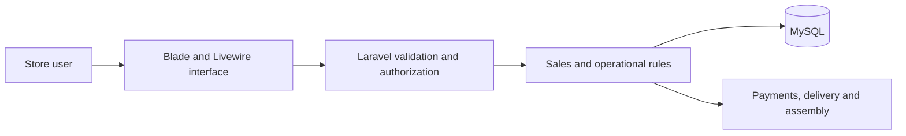

# Pinheiro Móveis

**Multi-store retail management · Independent development · Started in 2022**

[Portfolio](../README.md) · [Public site](https://pinheiromoveis.com)

## Business problem

Furniture retail connects several operations: a sale changes inventory, may create installment payments and must be followed through delivery and assembly. Store-level access also matters: an operational user should work within the correct store context.

## My contribution

I developed the application independently, including interfaces, backend business rules, database work and operational workflows. The project connects my practical experience in furniture, sales and marketing with full-stack development.

## Stack

| Area | Technologies |
| --- | --- |
| Backend | PHP, Laravel |
| Interface | Livewire, Blade, Alpine.js, Tailwind CSS |
| Persistence | MySQL |
| Verification | PHPUnit and application tests |
| Delivery | Git and Linux VPS deployment |

The interface of this project uses Laravel's server-driven stack. React and Next.js belong to other projects in this portfolio.

## Core workflows

- Store-scoped access to operational records.
- Sales and associated inventory changes.
- Installment-payment records and financial follow-up.
- Delivery and furniture-assembly workflows.

## Reliability scenarios

| Scenario | Behavior represented in the reviewed tests |
| --- | --- |
| An operator requests another store's customer by ID | Store boundaries are enforced beyond the navigation menu. |
| A stock count fails after some items were processed | The operation rolls back instead of leaving a partially reconciled inventory. |
| A payment notification is delivered twice | The same payment does not create duplicate installment allocations or receipts. |

[Review the exact test files and verification scope](../docs/engineering-evidence.md#private-implementation-review-pinheiro-móveis).

## Technical decisions

**Store boundaries are a server-side concern.** The application uses store scoping and authorization rules rather than relying on menu visibility to protect operational records.

**Related business changes belong together.** Database transactions help maintain consistency when sales and inventory records change as one operation. Monetary values use decimal storage rather than binary floating-point representation.

**Business rules should be testable.** Laravel services, request validation and authorization policies separate business behavior from screen rendering. The repository includes tests for store isolation and sales-related behavior.

## Verification and limits

The private repository contains automated tests and technical documentation. This public case study does not publish production records, credentials, source code or measured coverage. Test results depend on the revision and environment and should be reviewed alongside a specific commit.

The public site is an application entry point, not an unrestricted demonstration account. No shared production login is provided.

## Topics I can explain in an interview

- How store context affects queries and authorization.
- How a sale affects stock and financial records.
- Why transaction boundaries and decimal monetary values matter.
- How I translate operational needs into screens, rules and tests.

**Contact:** [lercsz1472@gmail.com](mailto:lercsz1472@gmail.com)
