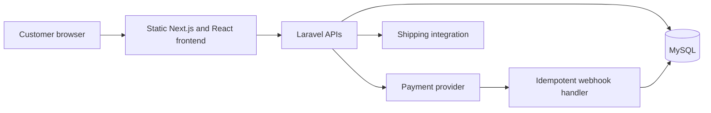

# Viure Maranhão

**Commerce experience and integrations · Independent development · Started in 2022**

[Portfolio](../README.md) · [Public website](https://viuremaranhao.com.br)

## Business problem

A commerce experience needs both a responsive public interface and reliable server-side behavior for identity, checkout, payments and external integrations. Marketing presentation and transactional rules have different responsibilities.

## My contribution

I developed the project independently across the frontend, Laravel backend, database and integrations. The work includes catalog and shopping journeys, authentication, payment handling and delivery-service integration. The implementation has evolved since the project began in 2022.

## Stack

| Area | Technologies |
| --- | --- |
| Public interface | Next.js, React, TypeScript, CSS |
| Backend | PHP, Laravel, REST APIs |
| Persistence | MySQL |
| Integrations | Asaas payments and Melhor Envio shipping |
| Verification | PHPUnit and Playwright |
| Delivery | Static frontend export and Linux VPS hosting |

## Technical decisions

**Keep the public frontend lightweight.** Next.js static export produces files that a web server can serve without a permanent Node.js application process. Authenticated and transactional behavior is handled through the backend APIs.

**Keep payment rules on the server.** Prices, private configuration and payment-provider credentials do not belong in browser-exposed environment variables. Laravel validates and processes the relevant operations.

**Treat webhook delivery as repeatable.** Payment integrations must tolerate repeated notifications. Idempotent processing avoids applying the same business effect more than once.

**Test the journey as well as the units.** Backend tests address authentication and payment behavior; browser tests address user journeys such as authentication during checkout while preserving cart context.

## Verification and limits

The public website shows the current published experience. The private codebase contains automated checks and implementation details; this document does not claim that every feature is enabled in every production deployment.

No conversion uplift, traffic volume, revenue, benchmark or test-coverage percentage is asserted. This case study excludes customer data, operational screenshots and private infrastructure details.

## Topics I can explain in an interview

- Static export and API integration tradeoffs.
- Server-side validation of identity and payment operations.
- Duplicate webhook handling and transaction boundaries.
- Preserving cart state through authentication.
- Relating commerce and marketing needs to implementation decisions.

**Contact:** [lercsz1472@gmail.com](mailto:lercsz1472@gmail.com)
