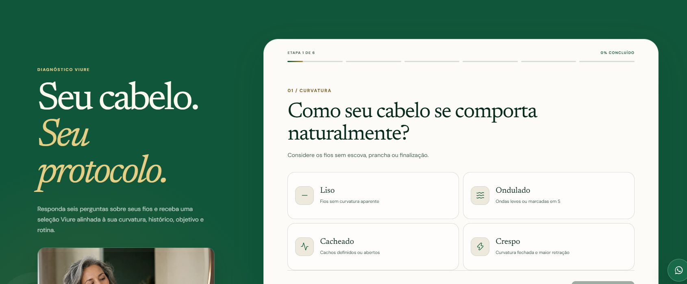
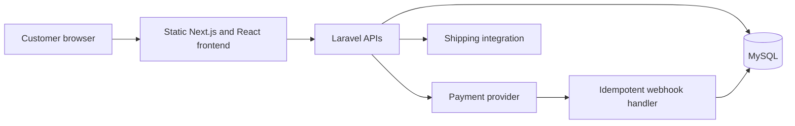

# Viure Maranhão

**Commerce experience and integrations · Independent development · Started in 2022**

[Portfolio](../README.md) · [Public website](https://viuremaranhao.com.br)

Public interface captured on November 1, 2026. Account and cart details are excluded from the capture.

## Business problem

A commerce experience needs both a responsive public interface and reliable server-side behavior for identity, checkout, payments and external integrations. Marketing presentation and transactional rules have different responsibilities.

## My contribution

I developed the project independently across the frontend, Laravel backend, database and integrations. The work includes catalog and shopping journeys, authentication, payment handling and delivery-service integration. The implementation has evolved since the project began in 2022.

## Stack

| Area | Technologies |
| --- | --- |
| Public interface | Next.js, React, TypeScript, CSS |
| Backend | PHP, Laravel, REST APIs |
| Persistence | MySQL |
| Integrations | Asaas payments and Melhor Envio shipping |
| Verification | PHPUnit and Playwright |
| Delivery | Static frontend export and Linux VPS hosting |

## Technical decisions

**Keep the public frontend lightweight.** Next.js static export produces files that a web server can serve without a permanent Node.js application process. Authenticated and transactional behavior is handled through the backend APIs.

**Keep payment rules on the server.** Prices, private configuration and payment-provider credentials do not belong in browser-exposed environment variables. Laravel validates and processes the relevant operations.

**Treat webhook delivery as repeatable.** Payment integrations must tolerate repeated notifications. Idempotent processing avoids applying the same business effect more than once.

**Test the journey as well as the units.** Backend tests address authentication and payment behavior; browser tests address user journeys such as authentication during checkout while preserving cart context.

### Payment events: persist first, reconcile when the payment exists

An external notification can arrive before the application has recorded the corresponding charge. The reviewed webhook service stores the provider event and keeps unmatched events available for replay. Once the payment can be matched, the same transaction updates payment state and its related stock or coupon effects. An already processed event is skipped.

**Example:** a payment event arrives before the local charge ID is saved. Discarding that event would lose an update; marking it processed immediately would prevent useful recovery. The implementation keeps it pending and provides a replay path after the payment is available. The reviewed tests exercise early and repeated events.

Customer email is sent after the database transaction. This keeps external network work outside the database lock, but a successful commit followed by an email failure still needs delivery recovery. It is not a durable outbox or a guarantee of exactly-once email delivery.

### Checkout retries: keep one attempt through uncertainty

The checkout attempt record includes an account, cart identity, key and creation time. The browser recovers a compatible stored attempt before preparing another. If storage is corrupted or a new attempt cannot be persisted, the flow stops instead of silently generating a replacement charge attempt.

This chooses duplicate-charge prevention over automatic progress during uncertain storage or network failures. The user needs a clear recovery action in that state. The tests cover stable keys and the failure paths; they do not establish browser storage as durable payment infrastructure.

## Reliability scenarios

| Scenario | Behavior represented in the reviewed tests |
| --- | --- |
| Payment events arrive repeatedly or before a charge ID is stored | Processing handles duplicates and tests the relationship between provider IDs and order references. |
| A visitor signs in while buying | Browser tests check cart, coupon and navigation context through the transition. |
| Checkout storage is corrupted or a recovery request fails | Tests check that the application does not silently rotate the attempt key and initiate a new charge. |
| A payment fails after stock was reserved | Tests check that reserved inventory is released once. |

[Review the exact test files and verification scope](../docs/engineering-evidence.md#private-implementation-review-viure-maranhão).

## Verification and limits

The public website shows the current published experience. The private codebase contains automated checks and implementation details; this document does not claim that every feature is enabled in every production deployment.

No conversion uplift, traffic volume, revenue, benchmark or test-coverage percentage is asserted. This case study excludes customer data, operational screenshots and private infrastructure details.

## Topics I can explain in an interview

- Static export and API integration tradeoffs.
- Server-side validation of identity and payment operations.
- Duplicate webhook handling and transaction boundaries.
- Preserving cart state through authentication.
- Relating commerce and marketing needs to implementation decisions.

**Contact:** [lercsz1472@gmail.com](mailto:lercsz1472@gmail.com)
